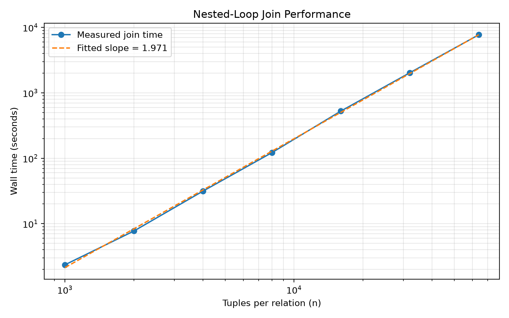

# Performance Report

## Environment

Machine: HP Pavilion x360 Convertible 14m-dy0xxx  
Processor: 11th Gen Intel(R) Core(TM) i3-1125G4 @ 2.00GHz  
Operating System: Windows  
Language: Python 3.11  

The relational algebra engine uses a nested-loop implementation for joins. No indexes, hash joins, or sort-merge joins are used.

## Join Experiment

The following query was measured:

`R join[R.b=S.b] S`

The join counter is incremented once for every pair of tuples whose join condition is evaluated.

### Results

| n | m | Comparisons | Wall Time (s) | Output Tuples |
|---:|---:|---:|---:|---:|
| 1,000 | 1,000 | 1,000,000 | 2.234465 | 1,000 |
| 2,000 | 2,000 | 4,000,000 | 7.900435 | 2,000 |
| 4,000 | 4,000 | 16,000,000 | 30.882528 | 4,000 |
| 8,000 | 8,000 | 64,000,000 | 121.743664 | 8,000 |
| 16,000 | 16,000 | 256,000,000 | 525.989665 | 16,000 |
| 32,000 | 32,000 | 1,024,000,000 | 2026.414598 | 32,000 |
| 64,000 | 64,000 | 4,096,000,000 | 7719.363992 | 64,000 |

## 1. Relationship Between n, m, and Comparison Count

The nested-loop join compares every tuple in relation R with every tuple in relation S.

Therefore, the comparison count is:

`comparisons = n × m`

For this experiment, both relations have the same size, so:

`m = n`

and therefore:

`comparisons = n²`

The measured comparison counts match this formula exactly for the completed experiments.

For example:

`1,000 × 1,000 = 1,000,000`

`2,000 × 2,000 = 4,000,000`

`4,000 × 4,000 = 16,000,000`

`8,000 × 8,000 = 64,000,000`

When n doubles, the number of comparisons becomes four times larger.

## 2. Log-Log Plot and Slope

## 2. Log-Log Plot and Slope

The following graph plots measured join wall time against the number of tuples per relation on log-log axes.

Using all seven measured data points, the fitted log-log slope is:

`1.9705`

A slope close to 2 indicates approximately quadratic growth. This agrees with the nested-loop structure of the join algorithm.

For relations R and S containing n and m tuples, respectively, the implementation evaluates the join condition for every possible pair:

`comparisons = n × m`

In this experiment, `n = m`, so:

`comparisons = n²`

Therefore, doubling the number of tuples in both relations should produce approximately four times as many comparisons. The measured results follow this pattern closely.

## 3. Selection and Projection Performance

n	    Selection time(s)	Tuples examined	Projection time(s)	Projection output
1,000	    0.001273	        1,000	         0.012906	    100
2,000	    0.002258	        2,000	         0.026510	    100
4,000	    0.004716	        4,000	         0.050945	    100
8,000	    0.009375	        8,000	         0.104340   	100
16,000	    0.019103	        16,000	         0.208504	    100
32,000	    0.040813	        32,000	         0.512707	    100
64,000	    0.089145	        64,000	         1.008844	    100

The selection experiment used `select[a>=0](R)`, which examined every input tuple. The measured selection counter matched the relation size exactly at every scale. Selection time increased approximately linearly because the implementation processes each input tuple once.

The projection experiment used `project[b](R)`, where attribute `b` had 100 distinct values. Although the input size increased from 1,000 to 64,000 tuples, the output consistently contained only 100 unique tuples. Projection took longer than selection because my implementation checks whether each projected tuple already exists before adding it to the result.

Both operations grew much more slowly than the nested-loop join over these measurements. The join compares every possible pair from two input relations, while selection scans a single relation and this projection experiment checks each input against a result containing at most 100 tuples.

## 4. Prediction for One Million Tuples Per Relation

A nested-loop join between one million tuples on each side would require:

`1,000,000 × 1,000,000 = 1,000,000,000,000`

tuple-pair comparisons.

I did not run this experiment, as required by the project specification. Instead, I estimated its running time using my largest measured experiment.

At 64,000 tuples per relation, the measured wall time was:

`7,719.363992 seconds`

The estimated time for one million tuples per relation is calculated using quadratic scaling:

`7,719.363992 × (1,000,000 / 64,000)²`

This gives:

`1,884,610.35 seconds`

or approximately:

`21.81 days`

Therefore, based on my measured performance, a nested-loop join of one million tuples on each side would take approximately 21.81 days of continuous execution.

This is an extrapolation rather than a measured runtime. Actual performance at that scale could differ because of factors such as memory usage, processor scheduling, and output-processing costs.

## 5. Effect of Match Rate

Match rate	Comparisons	Wall time (s)	Output tuples
1	        1,000,000	2.251974	    1,000
2	        1,000,000	2.371101	    2,000
4	        1,000,000	3.681972	    4,000

The experiment tested three match rates while keeping both input relations at 1,000 tuples each.

The comparison count remained exactly 1,000,000 for every match rate because the nested-loop join compares every tuple in R against every tuple in S, regardless of whether the tuples match.

However, the wall time changed. At match rate 1, the join took 2.251974 seconds and returned 1,000 tuples. At match rate 2, it took 2.371101 seconds and returned 2,000 tuples. At match rate 4, it took 3.681972 seconds and returned 4,000 tuples.

The higher match rates produced more output tuples, which required additional processing and duplicate checking in my implementation. This helps explain why the wall time increased even though the comparison count remained unchanged.

These measurements show the behavior observed in this experiment. Because each configuration was measured once, the exact timing differences may also include normal system variation.

The nested-loop implementation compares every tuple from R with every tuple from S before it can determine whether the pair matches.

Therefore, the comparison count should remain equal to `n × m` even when the match rate changes.

The wall time may still change because different match rates can produce different numbers of output tuples, and producing and deduplicating those tuples also takes time.

This claim will be checked using measured data.

## 6. Making the Million-Tuple Join Feasible

The current nested-loop join performs one comparison for every pair of tuples, which makes very large joins expensive. To make a million-tuple join practical, the implementation would need a more efficient join strategy such as a hash join or sort-merge join. An index could also reduce the amount of searching required for suitable join conditions. These approaches avoid comparing every tuple in one relation against every tuple in the other relation.

## Notes

The benchmark uses actual measured wall-clock times from this implementation. Estimated values are not entered into the results table as measured results.
